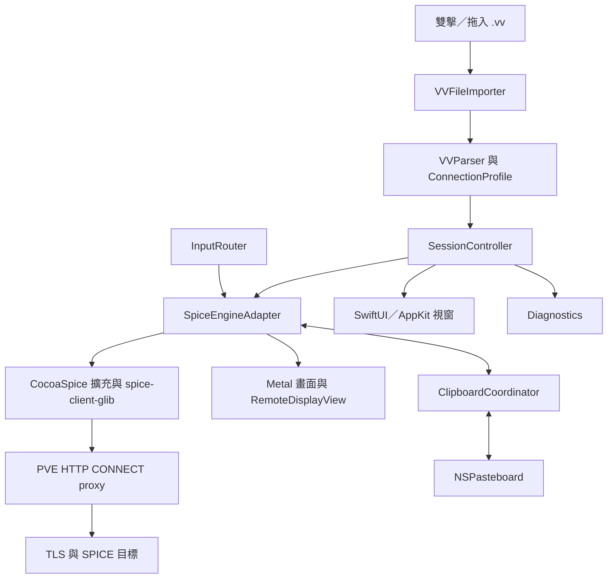

# macOS PVE Remote Viewer 技術規劃

版本：0.1／討論稿  
日期：2026-10-27  
依據：使用者提供的 `pve-spice.vv` 欄位，以及下列官方文件與原始碼。  
狀態：已完成設定檔靜態檢視；尚未建構程式、連線 PVE 或驗證剪貼簿穩定性。

## 1. 目標與範圍

製作原生 macOS 應用程式，讓使用者雙擊 PVE 下載的 `.vv` 即可開啟 SPICE 遠端畫面，並穩定使用雙向純文字剪貼簿。

第一版包含：檔案關聯、拖放匯入、PVE proxy、TLS 憑證驗證、票證驗證、單一遠端顯示器、鍵盤滑鼠、全螢幕、畫面縮放、手動及自動純文字剪貼簿、連線錯誤提示、去除機密的診斷紀錄。

後續再評估：音效、麥克風、多顯示器、圖片剪貼簿、檔案傳輸、USB、資料夾分享、PVE API 登入與自動取得新票證。第一版不儲存 PVE 帳號，也不實作 VM 管理功能。

平台暫定：優先 Apple Silicon、最低 macOS 13；這是產品規劃值，仍需依使用者電腦與鎖定依賴調整。Intel 與 Universal Binary 暫不列為第一版必要條件。

## 2. 範例檔案與必要行為

不在文件複製原始主機位址、票證、憑證內容或 VM 名稱。下表的埠號與快捷鍵來自範例，但實作必須讀取檔案，不能寫死。

| 欄位 | 範例狀態 | 實作行為 |
|---|---|---|
| `[virt-viewer]` | 存在 | 驗證必要區段 |
| `type` | `spice` | 第一版僅接受 SPICE |
| `host` | 存在 | 保留原始目標識別；不要改成 proxy 主機 |
| `proxy` | HTTP、3128、沒有 URL 帳密 | 傳給 SPICE 的 HTTP CONNECT proxy 設定 |
| `tls-port` | 61001 | 以 TLS 建立目標通道；不自動降級至明文 |
| `password` | 存在 | 本次工作階段使用，禁止寫入日誌與歷史紀錄 |
| `ca` | PEM 文字，含字面上的 `\n` | 按格式還原換行，作為本次連線的 CA |
| `host-subject` | 存在 | 映射至底層 certificate subject 驗證設定 |
| `title` | 存在 | 顯示於視窗標題，日誌另用 session ID |
| `delete-this-file` | 1 | 按第 7 節政策清理來源檔 |
| `toggle-fullscreen` | Shift+F11 | 切換 App 全螢幕 |
| `release-cursor` | Ctrl+Alt+R | 釋放輸入擷取 |
| `secure-attention` | Ctrl+Alt+Ins | 觸發傳送 Ctrl+Alt+Del 的動作，不是直接轉送原組合 |

檔案沒有提供一般 `port`，不可自行補上常見明文埠號。`password` 在這個 PVE 工作流程中當作連線票證使用；無法僅由欄位存在推斷目前是否有效。舊檔遭拒時應提示重新從 PVE 下載，不宣稱能自動更新票證。

`.vv` 是輸入資料。未知欄位只記錄欄位名稱或顯示相容性提示，不執行其中的文字、不開啟任意 URL，也不讓欄位決定 shell 指令。

## 3. 系統架構



圖中的 proxy 是傳輸路徑；TLS 對端驗證仍依 `.vv` 的目標與憑證設定處理。HTTP proxy 並不等於遠端畫面使用明文。SPICE 有多個 channel，必須確認後續 channel 也走相同 proxy 與 TLS 政策，不能只讓主 channel 成功。

| 模組 | 責任與邊界 |
|---|---|
| VVFileImporter | 檔案關聯、拖放、必要的 security-scoped 存取、來源檔清理；不建立連線 |
| VVParser | 按 virt-viewer INI／跳脫規則解析；檢查區段、重複關鍵欄位、資料大小、埠號與 URL 格式 |
| ConnectionProfile | 不可變設定；分開網路、TLS、驗證資料、視窗偏好、來源檔政策；禁止預設輸出機密的 description |
| SessionController | 每個工作階段的狀態、取消、重試、channel 事件、清理順序；不直接操作 pasteboard |
| SpiceEngineAdapter | 封裝 Objective-C／C API；套用設定、集中 callback 與執行緒轉接；UI 不持有 C 指標 |
| RemoteDisplayView | 使用 CocoaSpice renderer／Metal 顯示畫面，計算縮放、Retina 與輸入座標 |
| InputRouter | 鍵盤映射、滑鼠與滾輪、特殊按鍵、失焦後釋放按鍵、可見的釋放輸入入口 |
| ClipboardCoordinator | 工作階段授權、同步模式、資料快照、去重、大小限制、逾時及斷線取消 |
| Diagnostics | 記錄版本、session ID、狀態與錯誤分類；不記錄票證、原始 `.vv` 或剪貼簿內容 |

連線狀態：`idle → parsing → connecting → connected → disconnecting → disconnected`。任何階段都可進入 `failed`，並保存可顯示的錯誤分類。connecting 的細部進度以底層實際可觀察的事件為準，不顯示假進度。

第一版同一 process 運行 UI 與引擎；邊界先設計清楚，但不預先承諾可以零成本改成 XPC。若確認底層 C 崩潰仍持續，再評估每個 session 使用 helper process；這需要另做 Metal／IOSurface、輸入與生命週期的 IPC 設計。它可隔離 App 主介面，無法保證連線不中斷。

## 4. 技術與套件選型

| 技術／套件 | 用途 | 決策 |
|---|---|---|
| Swift、SwiftUI | App 狀態呈現、工具列、設定與錯誤視窗 | 採用 |
| AppKit | 檔案開啟、視窗事件、鍵盤滑鼠、NSPasteboard | 採用 |
| Metal／MetalKit | 遠端畫面與游標渲染 | 採用，優先重用既有 renderer |
| Foundation、UniformTypeIdentifiers | 設定模型、檔案與 `.vv` 類型宣告 | 採用 |
| OSLog | 經過遮蔽與去機密的診斷 | 採用 |
| CocoaSpiceNoUsb | 原生 SPICE bindings 與 renderer | 優先候選，需小範圍擴充及實機驗證 |
| libspice-client-glib-2.0 | SPICE channel、proxy、TLS、agent 通訊 | 核心依賴 |
| GLib／GObject／GIO | 底層事件迴圈、物件與 I/O | 核心依賴 |
| GStreamer | CocoaSpice 文件列出的連結依賴 | 原型先保留必要依賴，音訊功能先關閉；不得假定關閉音訊就可移除此依賴 |
| TLS／解碼等間接 C 依賴 | 由鎖定的 SPICE 建構組態決定 | 建構時產出完整依賴清單，不預先猜定版本 |
| XCTest | Parser、設定映射、狀態及剪貼簿邏輯測試 | 採用 |
| Xcode、Swift Package Manager | App 建置、原始碼套件整合、版本鎖定 | 採用 |
| Meson／Ninja／pkg-config | 建構及定位底層 C 依賴 | 依鎖定來源的建構要求使用 |

不需要 QEMU 或 libvirt 才能開啟遠端 PVE SPICE 工作階段。第一版不加入 Electron、WebView 或另一套網路引擎。

重要限制：CocoaSpice 的 SPM manifest 不代表已包含所有可直接散布的原生二進位依賴。官方 README 要求另外提供／連結 GLib、GStreamer、SPICE 等程式庫。必須建立可重現的底層建構與打包流程，不能只加入 SPM URL 就視為完成。

所有依賴鎖定至已驗證的 tag 或 commit；在原型成功後記錄 Xcode、SDK、最低系統版本、CPU 架構、編譯選項、來源雜湊及套件授權。CocoaSpice 本身與其底層依賴的授權不同，散布前逐項確認對應義務與 notices。

## 5. CocoaSpice 擴充範圍

公開 `CSConnection` 標頭提供 host、port、password 與 TLS public key 相關入口，但沒有直接提供本範例需要的 proxy、CA、certificate subject 設定。底層 SpiceSession 已有對應屬性，因此先評估維護小型 fork，避免在 Swift 端繞過封裝存取私有指標。

| `.vv` | SpiceSession 設定 |
|---|---|
| host | host |
| proxy | proxy |
| tls-port | tls-port |
| password | password |
| ca | ca，使用正確解碼後的 PEM bytes |
| host-subject | cert-subject |

另外明確設定並驗證 channel TLS 政策及 certificate verify flags。不得因 API 缺少而略過驗證，也不得將 CA PEM 直接當作 server public key 傳入；CA 信任與 public-key pinning 是不同用途。

擴充應只涵蓋：連線前原子式設定、錯誤分類、需要的剪貼簿控制入口、已證實的生命週期修復。先保留上游 renderer 與 channel 行為，便於後續更新與比對。

## 6. 剪貼簿設計

模式：關閉、手動傳送／取得、雙向自動。原型預設手動；自動模式通過驗收後再決定正式預設。剪貼簿寫入與遠端應用程式的「貼上」是兩件事，手動傳送不自動注入 Ctrl+V。

1. 先確認 guest agent 與剪貼簿 capability。缺少時提示不支援，畫面與輸入仍可使用。
2. NSPasteboard 操作集中在 MainActor；SPICE 操作必須經過其事件迴圈。Swift actor 本身不等於 GLib 執行緒排程。
3. 擷取文字後建立獨立資料快照；跨 callback 不使用借用的原始記憶體指標。
4. 僅同步純文字；拒絕圖片、檔案及未知格式，不自動轉成鍵盤輸入。
5. 自動同步追蹤 pasteboard changeCount、來源與內容指紋，避免回送迴圈。指紋只在記憶體使用，不寫入日誌。
6. 提案限制：UTF-8 編碼後上限 1 MiB；同時設定底層可用的大小限制。超限時提示，禁止靜默截斷。
7. 提案請求逾時 5 秒。所有請求綁定 session generation；斷線或重建後的舊回覆不得覆寫新剪貼簿。
8. 自動同步只允許作用中的遠端視窗，使用者切換視窗時取消舊授權與待處理請求。
9. 唯一 ClipboardCoordinator 持有同步政策；整合時確認未同時啟用 CocoaSpice 或 GTK 的另一套自動同步路徑。

1 MiB 與 5 秒是產品提案，需依實測修訂。此設計可降低常見競態風險，但不能宣稱已找出舊 remote-viewer 的崩潰原因。

## 7. 檔案與診斷政策

- 開發只使用去機密 fixture；原始範例不納入版本控制。
- 原始票證只供 session 使用，不做最近連線的永久儲存；Swift／C 記憶體管理不能保證所有副本立即清零，因此不宣稱安全抹除。
- 計畫在成功建立工作階段後，依 `delete-this-file=1` 刪除使用者匯入的原檔；失敗則保留供重試。這是本 App 明確選擇的清理時機。
- 刪除前核對匯入來源與檔案識別，防止誤刪同一路徑後來替換的檔案；不依檔案內容提供的任意路徑刪檔。
- 若無權刪除，連線繼續，提示來源檔仍存在；開發範例採明確保留模式。
- 錯誤分類至少包括檔案格式、proxy／網路、TLS、驗證資料遭拒、guest agent 不可用、剪貼簿超限及斷線。
- 底層錯誤字串也需遮蔽；不可直接把包含 URI 或設定物件的完整訊息輸出至 log。

## 8. 建議專案結構

```text
MacRemoteViewer/
  App/                       App 入口、檔案關聯、視窗與工具列
  Features/RemoteSession/    SessionController 與顯示狀態
  Core/VVFile/               匯入、解析、來源檔政策
  Core/Connection/           設定模型與錯誤型別
  Core/Clipboard/            同步狀態、去重與限制
  Platform/macOS/            AppKit、輸入、pasteboard、顯示整合
  Engine/                    SpiceEngineAdapter 與底層排程
  Diagnostics/               日誌遮蔽與診斷匯出
  Tests/Fixtures/            僅合成／去機密測試資料
  Tests/                     單元與整合測試
  BuildSupport/              依賴建構、版本清單、打包設定
  ThirdPartyNotices/         第三方授權與來源說明
```

## 9. 建構步驟與階段出口

以下是尚待執行的建構流程。專案與依賴腳本尚不存在，因此本文件不提供無法驗證的安裝指令。開始實作時，每條要求使用者執行的指令都需附上目的、影響與預期結果。

### 階段 A：確認環境與可重現依賴

1. 確認 Mac CPU、macOS、Xcode、PVE 與 guest OS 版本，建立測試矩陣。
2. 選定互相相容的 CocoaSpice 與 spice-gtk 來源版本，建立鎖定清單。
3. 建構底層程式庫與必要間接依賴，再整合 CocoaSpiceNoUsb。記錄每個建構選項與授權。
4. 建立最小 App，確認 renderer 與 GLib worker 可啟動及正常關閉。

出口：乾淨的開發環境可依文件重建；沒有依賴開發者私人路徑。

### 階段 B：設定解析與 TLS／proxy 原型

1. 建立 Parser 與合成 fixture，測試 CA 跳脫、埠號、布林值與重複欄位。
2. 擴充 CocoaSpice 設定入口，在 connect 前套用完整 profile。
3. 使用新下載的 `.vv` 實測 proxy、所有必要 channel、TLS 與票證。
4. 以受控錯誤設定測試 CA／subject 不符及連線遭拒，不修改 PVE 安全設定來繞過驗證。

出口：可顯示畫面、控制鍵盤滑鼠，驗證錯誤能辨識；若選型無法通過，先修正核心整合，不投入完整 UI。

### 階段 C：輸入與畫面

完成單顯示器、Retina 縮放、全螢幕、視窗縮放、滑鼠座標、快捷鍵及失焦釋放。Guest 解析度調整是條件性功能：agent 不支援時保留本地縮放。

出口：指定 guest OS 的一般桌面與文字編輯器可操作，不出現卡鍵或游標錯位。

### 階段 D：剪貼簿

先實作手動模式、agent capability 與斷線取消，再實作自動同步與視窗授權。用測試 adapter 注入延遲回覆及斷線，並在實際 VM 執行壓力測試。

出口：通過第 10 節的剪貼簿測項；若仍崩潰，保留 crash report 與重現步驟，依證據決定是否增加 helper process。

### 階段 E：macOS 整合與發布

1. 宣告 `.vv` 文件類型，完成雙擊、開啟檔案與拖放。
2. 完成錯誤 UI、設定、來源檔清理及診斷匯出。
3. 將必要 dylib／framework 與資源包進 App，修正 install names／rpath，確認沒有引用 Homebrew 或本機建構路徑。
4. 逐層簽署內嵌二進位與 App，啟用合適的 Hardened Runtime 設定。
5. 以 Developer ID 發布時，完成公證及 stapling，製作 DMG 或 ZIP。需要可用的 Apple Developer 簽署身分。
6. 在沒有 Xcode、Homebrew 或其他開發依賴的測試 Mac 驗證安裝與連線。

出口：交付可安裝 App、版本與依賴清單、操作說明、已知限制、測試結果。第一版以站外 Developer ID 散布為方向，App Store 與 App Sandbox 另做相容性評估。

## 10. 目標驗收功能

以下是建議的通過門檻，不是已完成的測試結果。先指定主要 guest OS 與標準測試網路，記錄所有版本及測試資料。

| ID | 功能／情境 | 通過條件 |
|---|---|---|
| F01 | 雙擊及拖放 `.vv` | 正確建立視窗與 session，不需手動輸入設定 |
| F02 | 無效檔案 | 缺區段、不支援 type、非法埠號、重複必要欄位均有明確提示，不崩潰 |
| F03 | PVE proxy | 必要 channel 均能經 proxy 運行；不偷偷改成直接連線 |
| F04 | TLS | 有效 CA／subject 可連線；錯誤 CA／subject 拒絕；不降級明文 |
| F05 | 票證遭拒 | 顯示驗證失敗與重新下載建議，不無限重試、不洩漏票證 |
| F06 | 顯示與縮放 | 指定 Retina／非 Retina 情境畫面比例與游標座標正確 |
| F07 | 輸入 | 字母、數字、修飾鍵、滾輪正常；切換 App 或失焦不殘留按下狀態 |
| F08 | 快捷鍵 | 範例三組快捷鍵可觸發對應動作，另有選單入口；說明 Fn 鍵可能影響功能鍵 |
| F09 | 手動文字剪貼簿 | 兩方向各 100 次，中文、英文、多行、emoji、空內容均符合定義且無資料損毀 |
| F10 | 自動文字剪貼簿 | 兩方向各 500 次，兩次複製間隔 200 ms 且每次有唯一編號；無崩潰、無回送迴圈，停止操作後兩端收斂到最後內容 |
| F11 | 邊界大小與格式 | 上限內文字正常；超過 1 MiB 明確拒絕且不截斷；圖片／檔案不誤送 |
| F12 | 同步中斷線 | 至少 20 次可重現測試；App 保持可操作，舊 callback 不改寫剪貼簿 |
| F13 | 無 guest agent | 顯示能力不足，剪貼簿停用；基本遠端畫面與輸入可用 |
| F14 | 視窗切換 | 若版本開放多個 session，僅作用中視窗同步；其他 VM 不收到文字；否則明確限制單 session |
| F15 | 長時間運行 | 連線 2 小時且定期同步文字，零 crash／hang；記錄記憶體走勢並排查持續成長 |
| F16 | 重複開關 | 用有效設定完成 30 次開啟／關閉，沒有殘留 worker、channel 或持續資源累積 |
| F17 | 來源檔清理 | 成功後依政策刪除；失敗保留；無權刪除有提示；不誤刪被替換的來源檔 |
| F18 | 診斷 | 用合成機密搜尋匯出 log，沒有票證、原始 `.vv`、剪貼簿或未遮蔽內部位址 |
| F19 | 可攜安裝 | 無開發工具的目標 Mac 可啟動、驗證簽章並完成 F01、F03、F04、F09 |

自動同步是「最後內容」語意，不保證保存快速連續複製的每個中間版本。剪貼簿同步成功也不代表所有遠端應用程式的貼上快捷鍵都相同。中文文字傳輸與中文輸入法鍵盤整合分開驗證。

## 11. 風險、決策點與待確認項目

| 項目 | 風險／未知 | 處理方式 |
|---|---|---|
| 舊 App 崩潰原因 | 尚無 crash report，不知道是否位於共用底層 | 收集版本與重現條件，不宣稱換 UI 就能修復 |
| CocoaSpice 相容性 | 公開入口不足；版本組合可能不相容 | 階段 B 作為核心選型門檻 |
| 原生依賴打包 | SPM 不會自動完成全部 C 依賴散布 | 階段 A 建立可重現流程，階段 E 做乾淨機驗證 |
| 多執行緒 | callback 與斷線清理競態 | 統一排程、generation 與明確所有權；以 Sanitizer 協助診斷 |
| Guest 差異 | agent、桌面環境及版本影響剪貼簿 | 明確列出已驗證組合與能力提示 |
| 可發布性 | 簽署身分、第三方授權、系統版本待確認 | 發布前完成依賴清單及實際安裝測試 |

實作前需要確認：Mac 架構及 macOS 版本、主要 Windows／Linux guest 與 agent 版本、舊 remote-viewer 來源與崩潰方向、第一版是否只供自用、是否需要 Intel。

原始 `.vv` 僅證明檔案格式與設定需求；它無法證明網路目前可達、票證有效、VM agent 正常或上述架構已通過實測。

## 12. 官方參考來源

- [remote-viewer 連線檔與快捷鍵語意](https://gitlab.com/virt-viewer/virt-viewer/-/blob/master/man/remote-viewer.pod)
- [CocoaSpice README：能力與原生連結依賴](https://github.com/utmapp/CocoaSpice/blob/main/README.md)
- [CocoaSpice Package.swift：套件產品與建構設定](https://github.com/utmapp/CocoaSpice/blob/main/Package.swift)
- [CSConnection.h：公開連線 API](https://github.com/utmapp/CocoaSpice/blob/main/Sources/CocoaSpice/include/CSConnection.h)
- [SpiceSession：proxy、CA、subject、TLS 與 channel 設定](https://www.spice-space.org/api/spice-gtk/SpiceSession.html)
- [SpiceMainChannel：剪貼簿 API 與能力資訊](https://www.spice-space.org/api/spice-gtk/SpiceMainChannel.html)
- [UTM 架構：CocoaSpice 與 Metal 整合](https://github.com/utmapp/UTM/blob/main/Documentation/Architecture.md)

以上連結是本次選型依據；正式實作需記錄鎖定版本，不把 main 分支當成固定規格。
